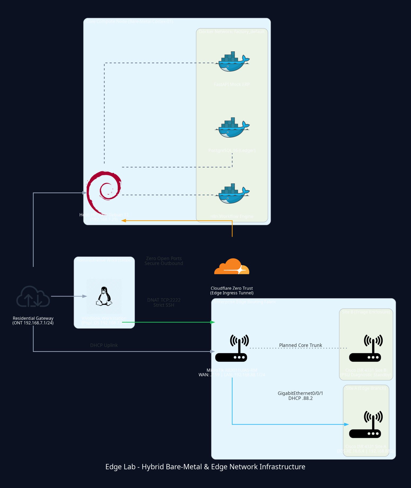

# Edge Lab Infrastructure (Hybrid Bare-Metal & Edge Network Engineering)

<p align="center">
  
  
  
  
  
  
</p>

---

## 🏛 Executive Summary & Engineering Philosophy

The **Edge Lab** is an enterprise-grade, hybrid physical-and-compute infrastructure platform engineered by **Philipe Oliveira da Silveira**. 

Backed by **more than 20 years of real-world operations in IT infrastructure, telecommunications, ISP engineering, and mission-critical systems management**, this platform serves as a living, continuous-learning operational proving ground. It bridges physical bare-metal hardware and edge networking equipment with modern cloud-native architectures, platform engineering, and automated governance.

### The Philosophy: Constraint-Driven Engineering
In enterprise environments, throwing infinite cloud budget at software architecture frequently conceals structural inefficiencies, memory leaks, and poor concurrency designs. The Edge Lab operates under a deliberate **Constraint-Driven Engineering** paradigm:
* Systems are architected, deployed, and validated under strict memory, compute, and physical network boundaries.
* If a platform can achieve sub-second transactional idempotency, zero-downtime ledger recovery, and robust telemetry on a 12GB bare-metal Debian host and legacy edge routers, it demonstrates the engineering discipline required to run multi-million-dollar cloud infrastructures with radical FinOps efficiency.

---

## 🌐 Official Enterprise Architecture Blueprint

<p align="center">
  
</p>

### Physical & Logical Topology Blueprint

```text
[ Residential WAN / Gateway (192.168.7.1/24) ]
│
├── [ Admin Workstation: Pop!_OS Laptop (192.168.7.58) ]
│
├── [ Core Router: MikroTik RB3011UiAS-RM (WAN: 192.168.7.59) ]
│         │
│         └── LAN Bridge: 192.168.88.1/24 (Ports ether2–ether10)
│                   │
│                   ├── [ Cisco ISR 4331 Site A (Gi0/0/1: 192.168.88.2) ]
│                   │         (Restricted DNAT via RB3011: TCP 2222 -> Port 22)
│                   │
│                   └── [ Cisco ISR 4331 Site B (Hardware Triage Standby) ]
│
└── [ Compute Node: Cortex-01 Bare-Metal (Debian 12: 192.168.7.29) ]
          │
          └── Cloudflare Zero Trust Ingress (Zero Open Inbound Ports)
```

---

## 🛠 Multi-Disciplinary Engineering Competencies

This infrastructure provides demonstrable, verifiable evidence across multiple enterprise engineering domains:

| Engineering Domain | Real-World Operational Implementation in Edge Lab | Supported Portfolio Workloads |
| :--- | :--- | :--- |
| **Platform Engineering** | Bare-metal Linux host administration (Debian 12 minimal), unified Docker Compose topologies, resource quota containment (`mem_limit`), and container lifecycle automation. | [IAM-HR Platform](https://github.com/PhilipeOliveiraS/iam-hr-offboarding-platform) (Postgres 16, n8n, FastAPI ERP). |
| **NetDevOps & Edge Networking** | RouterOS 7.23.7 long-term automation, VLAN/bridge segmentation, strict stateful firewall input chains, and Cisco IOS-XE 16.6.4 modular edge routing. | Future **OpsCore** physical telemetry aggregator & physical network enforcement. |
| **Zero Trust & DevSecOps** | Elimination of public perimeter exposure via Cloudflare Zero Trust Tunnels, out-of-band management restrictions (ACLs limiting VTY/SSH strictly to admin host `192.168.7.58`), and cryptographic hygiene. | End-to-end identity revocation and credential quarantine. |
| **Cloud FinOps & Capacity Planning** | Measuring true cost-of-compute by comparing local bare-metal performance baselines against variable cloud IaaS/PaaS pricing (NAT Gateways, egress traffic, managed container runtimes). | High-efficiency microservice deployments and synthetic workload simulation. |

---

## 📑 Architecture Decision Records (ADR Suite)

Key infrastructure and topology decisions are formally governed following the MADR standard:

1. [ADR 0001: Constraint-Driven Bare-Metal Compute Platform](docs/adr/0001-constraint-driven-bare-metal-compute.md) — Rationalizing the Debian 12 Cortex-01 bare-metal node for resilient local hosting.
2. [ADR 0002: MikroTik & Cisco Hybrid Edge Fabric](docs/adr/0002-mikrotik-cisco-hybrid-edge-fabric.md) — Segregating core routing, DNAT out-of-band management, and edge branch topologies.
3. [ADR 0003: Cloudflare Zero Trust Perimeter Ingress](docs/adr/0003-cloudflare-zero-trust-ingress.md) — Enforcing zero open inbound WAN ports for local enterprise microservices.

---

## 🏢 Enterprise Advisory & Infrastructure Consulting

This environment was conceived, built, and operated by **Philipe Oliveira da Silveira** as a testament to lifelong practical engineering, operational resilience, and relentless problem-solving.

For organizations seeking high-impact expertise in **Cloud Platform Engineering, NetDevOps, Hybrid Infrastructure Architecture, or Identity & Access Governance**:

* **Principal Architect & Platform Lead:** Philipe Oliveira da Silveira
* **Email:** [philipeoliveira1984@gmail.com](mailto:philipeoliveira1984@gmail.com)
* **LinkedIn:** [linkedin.com/in/philipeoliveiras](https://www.linkedin.com/in/philipeoliveiras/)
* **GitHub:** [github.com/PhilipeOliveiraS](https://github.com/PhilipeOliveiraS)
* **Live Sandbox Verification:** [IAM-HR Enterprise Sandbox](https://iam-hr.ph3digital.com.br/iam-hr-sandbox)
